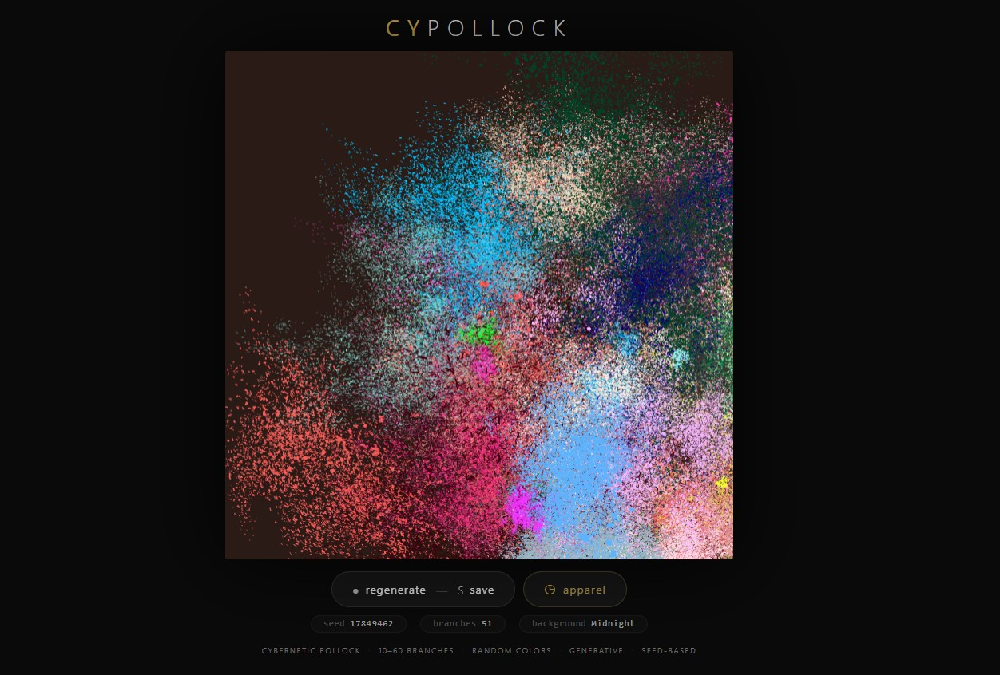
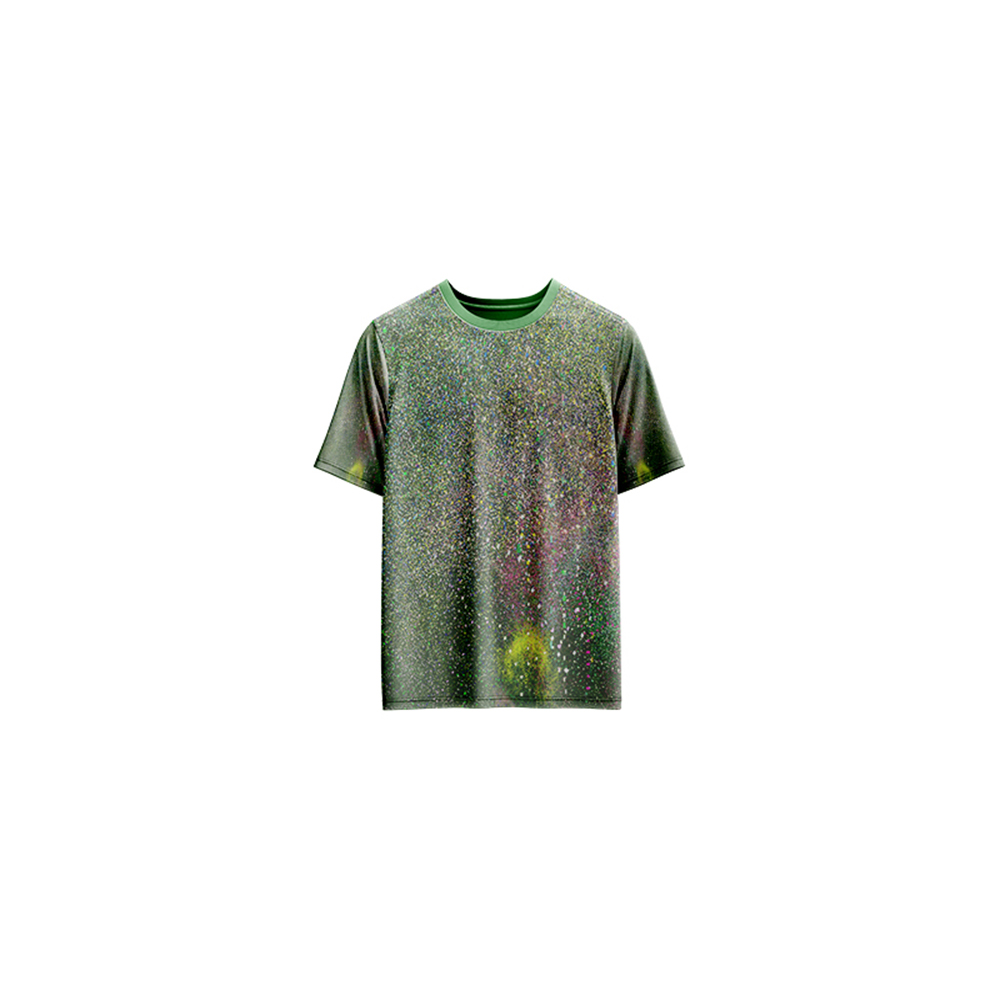

# cyPollock — Generative Art

[](https://reyrove.github.io/cyPollock-Generative-Art)
[](https://opensource.org/licenses/MIT)

> **Cybernetic Pollock-inspired generative art.** Each refresh creates a unique abstract composition of branching lines with random colors, inspired by the chaotic beauty of Jackson Pollock's drip paintings.

## 🎨 Live Demo

<div align="center">
  <a href="https://reyrove.github.io/cyPollock-Generative-Art" target="_blank">
    
  </a>
  <br><br>
  <a href="https://reyrove.github.io/cyPollock-Generative-Art" target="_blank">
    
  </a>
  <br>
  <em>Click the image or button to experience the generative art</em>
</div>

## 👕 Apparel Preview

<div align="center">
  
  <br>
  <em>cyPollock artwork printed on a T-shirt</em>
</div>

## ✨ Features

- **Pollock-Inspired** — Chaotic, organic line patterns
- **Branching Trees** — Recursive branching with random rotations
- **Rich Color Palettes** — 22 dark backgrounds + 75 vibrant branch colors
- **Generative Chaos** — Random positions, sizes, and angles
- **Seed-Based** — Every composition is unique and reproducible via its seed
- **Save & Share** — Download as PNG with seed in filename
- **Apparel Mode** — Preview artwork on a T-shirt mockup
- **Responsive** — Works on desktop, tablet, and mobile
- **Pure JavaScript** — No external dependencies
- **Keyboard Shortcuts**:
  - `R` — Regenerate
  - `S` — Save image
  - `T` — Toggle apparel view

## 🎨 Artwork Details

| Parameter | Range | Description |
|-----------|-------|-------------|
| **Number of Branches** | 10–60 | Random branch groups |
| **Branch Colors** | 75+ options | Vibrant random colors |
| **Background Colors** | 22 options | Dark cosmic palette |
| **Branch Depth** | Up to 13 | Recursive branching levels |
| **Branch Width** | Variable | Scales with canvas size |
| **Rotation** | Random | Full 360-degree rotation |

## 🎯 How It Works

The artwork creates abstract, Pollock-like compositions using recursive branching:

1. **Setup**:
   - Random dark background color from 22 options
   - Random number of branch groups (10-60)
   - Each branch gets a random color from 75+ options

2. **Branch Generation**:
   - Each branch starts at a random position
   - Recursive branching creates organic patterns
   - Random rotation and scaling at each level
   - Depth up to 13 levels

3. **Rendering**:
   - All branches drawn on dark background
   - Vibrant colors create contrast
   - Chaotic, organic composition

## 🚀 Quick Start

### Local Development

```bash
# Clone the repository
git clone https://github.com/reyrove/cyPollock-Generative-Art.git

# Navigate to the directory
cd cyPollock-Generative-Art

# Open in browser
open index.html
# or use a live server
```

### Deploy to GitHub Pages

1. Push to GitHub
2. Go to Settings → Pages
3. Select branch `main` and root folder
4. Your site will be live at `https://reyrove.github.io/cyPollock-Generative-Art`

## 🧠 How It Works

The artwork is generated using a deterministic random number generator, seeded by timestamp + random noise. Every refresh:

1. **Setup**:
   - Random background color from 22 dark colors
   - Random number of branch groups (10-60)
   - Each branch assigned a random color from 75+ vibrant colors

2. **Branch Generation**:
   - Each branch starts at a random position on canvas
   - Recursive function creates branching patterns
   - Each branch has random rotation and scaling
   - 30% chance of splitting into two branches

3. **Rendering**:
   - All elements drawn on dark background
   - Vibrant, contrasting colors
   - Organic, chaotic composition reminiscent of Pollock

## 📁 File Structure

```
cyPollock-Generative-Art/
├── index.html          # Main application (all-in-one)
├── cyPollock.jpg       # T-shirt mockup image
├── fav.svg             # Favicon
├── demo-screenshot.jpg # Website demo screenshot
├── README.md           # This file
└── LICENSE             # MIT License
```

## 🛠️ Tech Stack

- **Pure Vanilla HTML/CSS/JS** — No dependencies
- **Canvas API** — 2D rendering
- **CSS Flexbox/Grid** — Responsive layout
- **GitHub Pages** — Hosting

## 🎯 Interactive Controls

| Action | Keyboard | Button |
|--------|----------|--------|
| Regenerate | `R` | Click "regenerate" |
| Save Image | `S` | Click "regenerate" |
| Toggle Apparel | `T` | Click "apparel" |

## 🎨 The Creative Process

### Pollock Inspiration
Jackson Pollock was known for his "drip" technique, creating chaotic, layered compositions. This artwork captures that spirit through algorithmic chaos.

### Recursive Branching
Each branch has a chance to split into two, creating organic, tree-like structures. Random rotation and scaling at each level ensure no two branches are alike.

### Color Chaos
75+ vibrant colors are randomly assigned to each branch, creating a chaotic, colorful composition against a dark background.

### Generative Chaos
Random positions, sizes, angles, and depths create a unique composition every time, capturing the essence of Pollock's unpredictable style.

## 📱 Responsive Design

The application automatically adapts to:
- Desktop screens
- Tablets
- Mobile phones
- Landscape orientation
- Various aspect ratios

## 🤝 Contributing

Contributions are welcome! Feel free to:
- Fork the repository
- Create a feature branch
- Submit a pull request

### Ideas for Contributions:
- New branching algorithms
- Additional color palettes
- Animation features
- Performance optimizations

## 📄 License

MIT License — see [LICENSE](LICENSE) file for details.

## 🙏 Acknowledgments

- Inspired by Jackson Pollock's drip paintings
- Pure JavaScript implementation
- Special thanks to the creative coding community

---

**Built with ❤️ and cybernetic chaos**